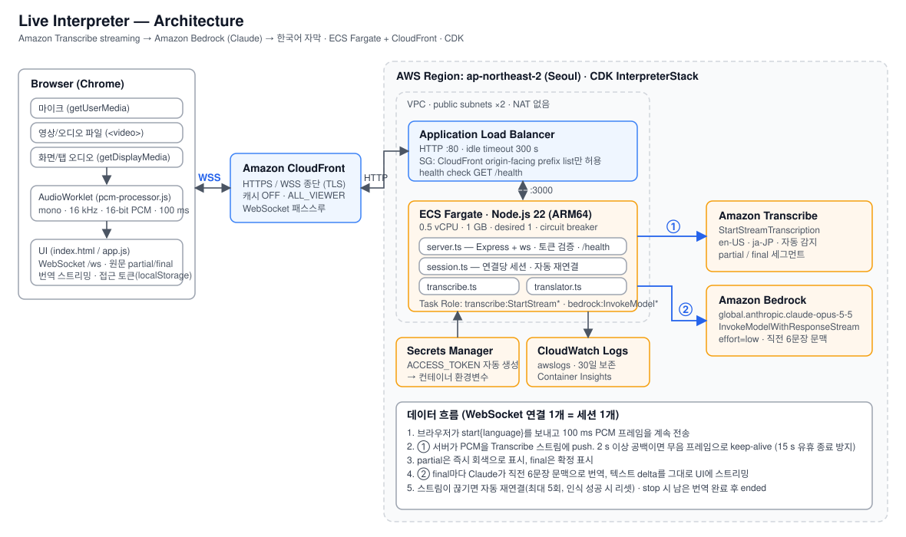
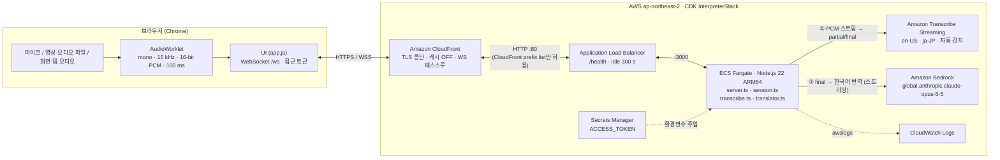
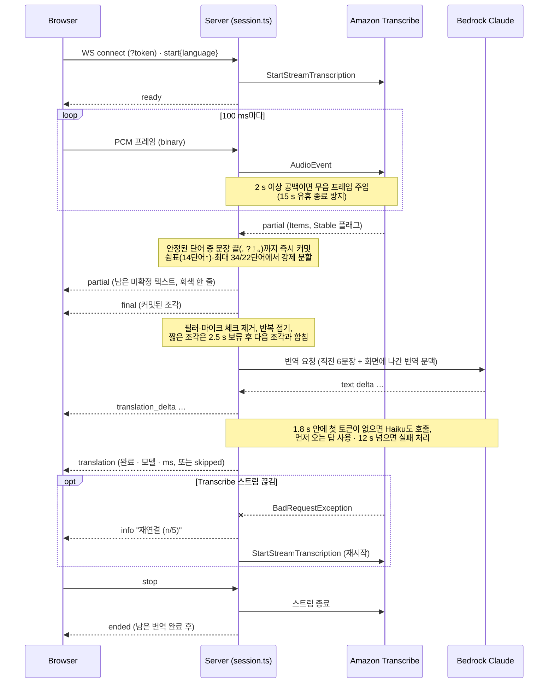

# Live Interpreter

마이크 · 영상/오디오 파일 · 화면(탭) 오디오를 입력받아 **원문(영어/일본어)**과 **한국어 번역**을 실시간으로 보여주는 웹앱입니다.

## 아키텍처



> 원본: `docs/architecture.svg` (편집 가능), `docs/architecture.png` (슬라이드용)



### 세션 시퀀스



## 실행

```bash
cp .env.example .env     # 리전/모델 조정
npm install
npm run dev              # http://localhost:3000 (개발, 자동 재시작)
npm run build && npm start   # 프로덕션 모드 (dist/)
```

AWS 자격증명은 기본 credential chain(`AWS_PROFILE`, 환경변수, SSO 등)을 사용합니다.
필요 권한: `transcribe:StartStreamTranscription`, `bedrock:InvokeModelWithResponseStream`.

> 마이크/화면 캡처는 `localhost` 또는 HTTPS에서만 동작합니다.

## 설정 (.env)

| 변수 | 기본값 | 설명 |
|---|---|---|
| `AWS_REGION` | `ap-northeast-2` | Transcribe 스트리밍 리전 |
| `BEDROCK_REGION` | `ap-northeast-2` | Bedrock 리전 (global inference profile 사용) |
| `BEDROCK_MODEL_ID` | `global.anthropic.claude-opus-5-5` | 번역 모델. 지연시간을 줄이려면 `global.anthropic.claude-haiku-5-5` |
| `BEDROCK_FALLBACK_MODEL_ID` | `global.anthropic.claude-haiku-5-5` | 메인 모델이 느리거나 실패하면 같이 호출하는 모델. 빈 값이면 끔 |
| `HEDGE_AFTER_MS` | `1800` | 메인 모델 첫 토큰이 이 시간 안에 없으면 폴백 모델도 호출 |
| `TRANSLATE_DEADLINE_MS` | `12000` | 이 시간 안에 어느 모델도 답하지 않으면 해당 줄을 실패로 표시 |
| `TRANSLATE_EFFORT` | `low` | Claude effort (`low`/`medium`/`high`) |

문장 분할·필러 기준(`commit.longWords`, `maxWords`, `minWords`, `holdMs`)은 `src/config.ts`에 있습니다.
| `PORT` | `3000` | 웹 서버 포트 |

## 입력 언어 추가

`src/languages.ts`의 `INPUT_LANGUAGES` 배열에 한 줄만 추가하면 됩니다.
(Transcribe 스트리밍이 지원하는 언어 코드여야 합니다.)

```ts
{ code: "zh-CN", label: "中文", name: "Mandarin Chinese" },
```

"자동 감지"는 이 배열의 모든 언어를 `IdentifyMultipleLanguages` 후보로 넘깁니다.
언어를 미리 알고 있으면 직접 선택하는 쪽이 첫 몇 초의 인식 정확도와 문장 분할이 더 좋습니다.

## 구조

```
src/
  server.ts      Express 정적 서빙 + WebSocket(/ws)
  session.ts     연결 1개 = 세션 1개. 커밋된 조각의 필러 제거·보류·중복 제거 → 번역 → 클라이언트 메시지
  transcribe.ts  Transcribe 스트리밍 세션 + 안정 단어 기준 조기 커밋 (오디오 시간 커서로 중복 커밋 방지)
  translator.ts  Bedrock Claude 번역 (스트리밍, 헤징·폴백·데드라인, <skip/> 센티널, 자막 형태 검증, 워밍업)
  captioning.ts  자막 텍스트 규칙: 필러/마이크 체크, 반복 접기, 재전송 중복, 모델이 자막 대신 답변했는지 검사
  languages.ts   지원 입력 언어 목록
  config.ts      환경변수
public/
  index.html / app.js / style.css   UI
  pcm-processor.js                  AudioWorklet: 모노 다운믹스 + 16 kHz 리샘플 + 16-bit PCM
scripts/
  smoke-test.ts  PCM 파일을 실시간으로 흘려 보내 end-to-end 확인
```

### WebSocket 프로토콜

클라이언트 → 서버: `{"type":"start","language":"auto|en-US|ja-JP"}`, 바이너리 PCM 프레임, `{"type":"stop"}`
서버 → 클라이언트: `ready`, `partial`, `final`, `translation_delta`, `translation`, `info`, `ended`, `error`

- `partial {id, text}`: 아직 커밋되지 않은 텍스트. 화면에는 한 줄만 유지하며 `text`가 비면 지웁니다.
- `final {id, text, language}`: 커밋된 조각. `id`는 `<ResultId>:<n>` 형식으로 한 결과에서 여러 번 나올 수 있습니다.
- `translation {id, text, model, ms, skipped?, failed?}`: `skipped`는 모델이 내용 없음(`<skip/>`)으로 판단한 줄, `failed`는 데드라인 초과·거부.

자막 파이프라인의 조기 커밋, 필러·조각 처리, 헤징 구조는 [leeay0219/live-interpreter](https://github.com/leeay0219/live-interpreter) (Apache-2.0)를 참고해 옮겼습니다.

## AWS 배포 (CDK)

구성은 위 [아키텍처](#아키텍처) 다이어그램 참고.

배포 리전은 셸의 `AWS_REGION`과 무관하게 **ap-northeast-2(서울)** 로 고정되어 있습니다. 바꾸려면 `-c region=...`.

- CloudFront가 TLS를 제공하므로 도메인 없이도 마이크/화면 캡처가 동작합니다 (`*.cloudfront.net`).
- ALB 보안그룹은 CloudFront origin-facing prefix list에서만 80 포트를 허용합니다.
- 접근 토큰이 Secrets Manager에 자동 생성되어 컨테이너에 `ACCESS_TOKEN`으로 주입됩니다. UI 첫 접속 시 한 번 입력하면 브라우저에 저장됩니다.
- Task Role 권한: `transcribe:StartStreamTranscription`, `bedrock:InvokeModel*` (anthropic 모델 / inference profile 한정)
- NAT 게이트웨이 없이 퍼블릭 서브넷 + 퍼블릭 IP로 운영해 고정 비용을 최소화했습니다.

### 사전 조건

- Docker 데몬 실행 중 (`cdk deploy`가 ARM64 이미지를 빌드해 ECR에 푸시)
- 서울 리전에 CDK bootstrap 완료 (완료 상태 확인됨)
- 대상 계정에서 Bedrock Claude 모델 접근 활성화

### 배포

```bash
cd infra && npm install && cd ..
npm run infra:synth    # 템플릿 확인
npm run infra:deploy   # 서울 리전에 배포
```

출력값 `Url`이 접속 주소, `GetAccessTokenCommand`를 그대로 실행하면 접근 토큰이 나옵니다.

옵션 (CDK context):

```bash
cd infra && npx cdk deploy \
  -c domainName=interp.example.com \
  -c certificateArn=arn:aws:acm:us-east-1:...:certificate/...   # CloudFront용 인증서는 us-east-1
  -c bedrockModelId=global.anthropic.claude-haiku-5-5 \
  -c bedrockRegion=us-east-1
```

삭제: `npm run infra:destroy`

### 운영 메모

- 로그: 출력값 `LogGroup` (CloudWatch Logs, 30일 보존)
- 재배포: 코드 수정 후 `npm run infra:deploy` 하면 새 이미지 빌드 → 롤링 배포 (circuit breaker 롤백 포함)
- 다중 사용자 보안이 필요하면 ALB에 ACM 인증서 + Cognito 인증을 붙이는 것이 다음 단계입니다. 현재는 공유 토큰 1개입니다.

## 스모크 테스트

```bash
say -v Samantha -o en.aiff "Good morning everyone."
ffmpeg -i en.aiff -f s16le -acodec pcm_s16le -ac 1 -ar 16000 en.pcm
npm run dev &
npm run smoke -- en.pcm en-US
```
